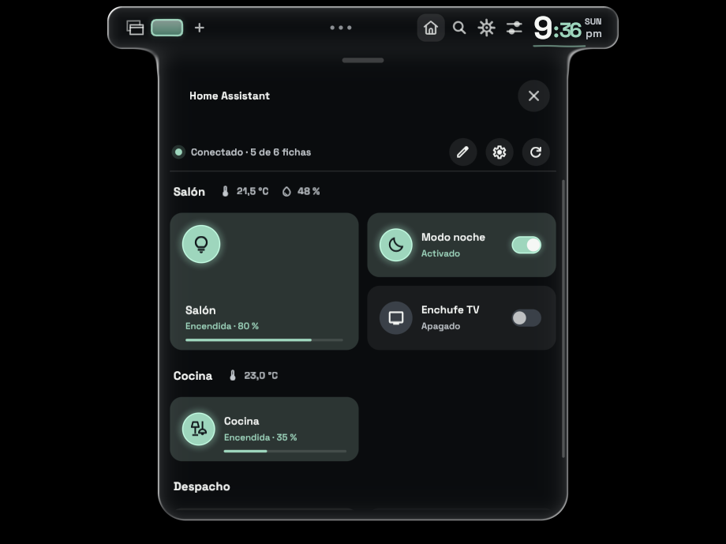
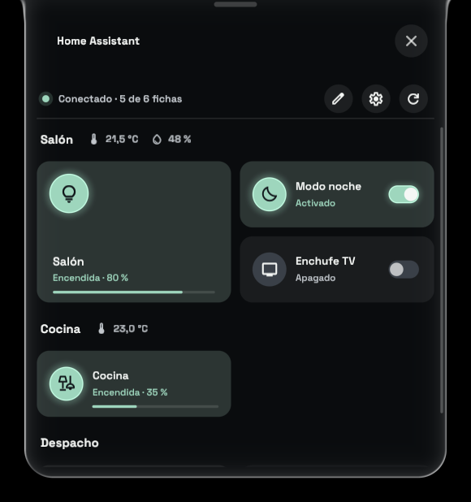
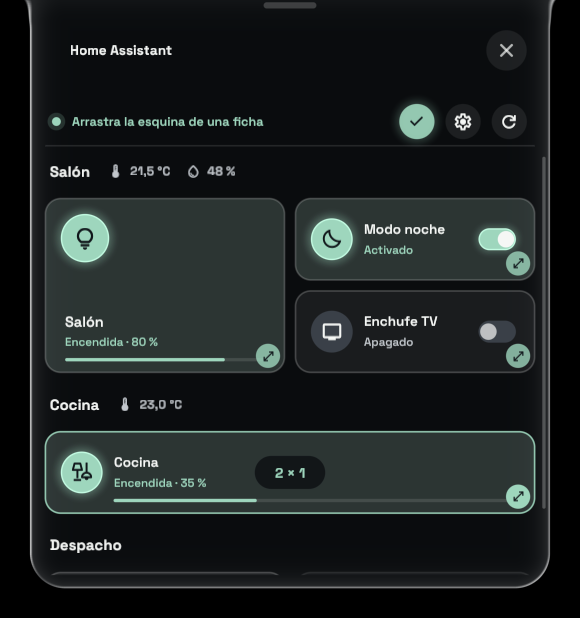
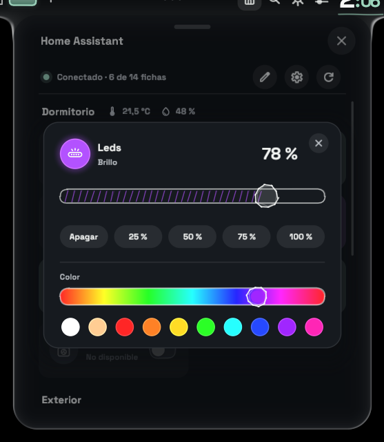
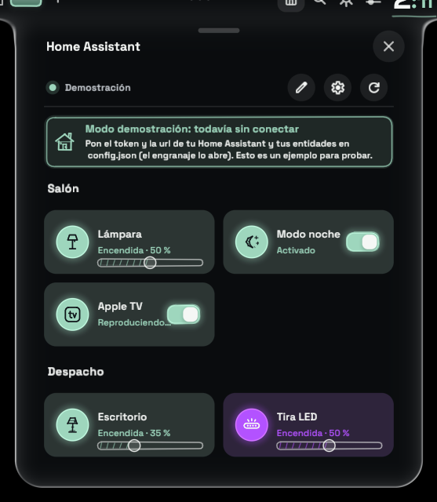
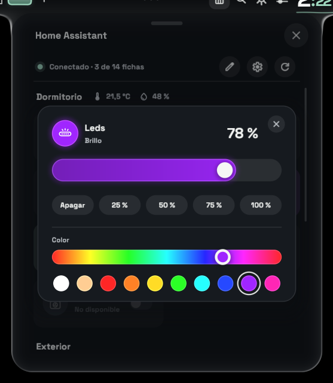
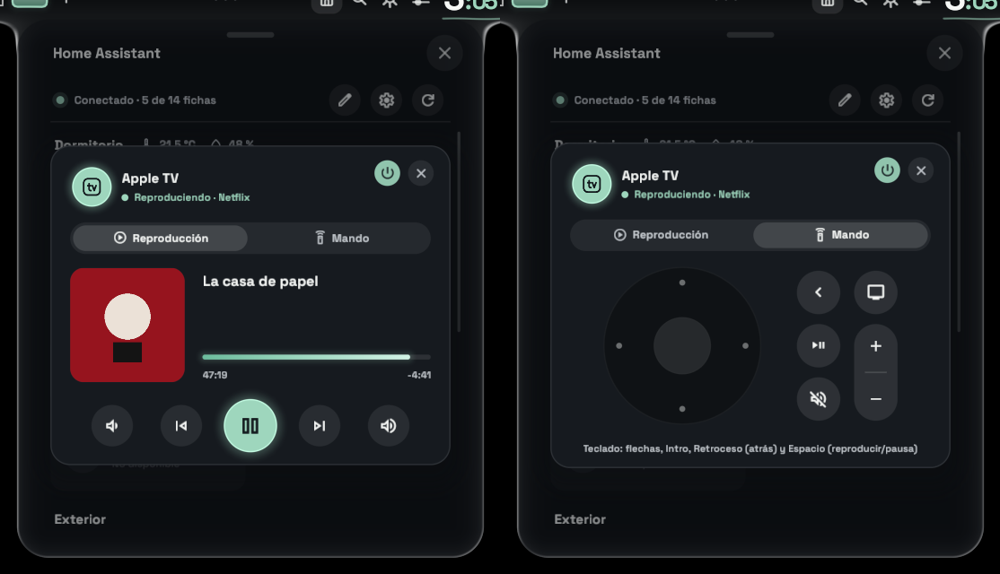
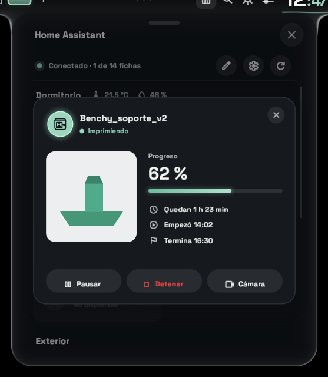

# Home Assistant para Vitreus

Un addon de [Vitreus](https://github.com/natepayn3/Vitreus) que pone tus luces e interruptores de Home Assistant en un panel con el cristal de la propia shell, separados por habitaciones.

*[Read in English](README.md)*



- **Habitaciones**, cada una con su nombre y, si le pones sensores, su temperatura y humedad.
- **Clic** en una ficha: enciende o apaga. **Clic derecho** en una luz: abre el control de brillo (arrastra, usa la rueda o pulsa Apagar / 25 / 50 / 75 / 100 %).
- **Colores**: una luz con `"color": true` tiene además en ese control un arcoíris y una fila de colores hechos; con `"tint": true` su ficha y su control se dibujan del color que tiene.
- **Apple TV**: un clic derecho en su ficha abre una tarjeta con lo que se está reproduciendo (carátula, título, progreso, controles y volumen) y un mando como el Siri Remote, que también se maneja con el teclado.
- **Impresoras 3D**: un clic derecho en la ficha de una impresora abre una tarjeta con la portada o la cámara, el progreso, los tiempos y sus botones.
- **Fichas del tamaño que quieras**: el lápiz pone el panel en modo edición, y el tirador de la esquina de cada ficha la hace más ancha (hasta 4 columnas) o más alta (hasta 3 filas). Los tamaños se guardan.
- **En la isla**: arrastra la pieza de add-ons a la barra (Ajustes > Bar > Island layout) y el panel se despliega desde la barra como los paneles de la shell.
- **Estética de Vitreus**: toma la paleta y el tema de la shell, y cambia con ellos; sus interruptores, sliders e iconos son los del Centro de control, a lápiz (de la plantilla de add-ons de Vitreus), y el contenido entra como el del Centro de control.
- **Una demostración** hasta que lo configuras: sin token en `config.json` el panel lo avisa arriba y deja probar las habitaciones del ejemplo.
- **En cualquier idioma**: inglés por defecto, español incluido, y cualquier otro con un archivo JSON que añadas (French.json, por ejemplo): `"language"` en su configuración lo elige.

| El panel | Modo edición | Brillo |
| --- | --- | --- |
|  |  |  |

## Instalar

```sh
git clone https://github.com/datingesp-hash/HomeAssistant-Vitreus-Addon ~/.config/pleamar/vitreus-addons/homeassistant
```

Después, actívalo en **Ajustes > Add-ons**. Para actualizarlo más adelante:

```sh
git -C ~/.config/pleamar/vitreus-addons/homeassistant pull
```

Necesita un Vitreus con add-ons, y `curl`.

## Configurar

La primera vez crea `~/.local/share/pleamar/homeassistant/config.json` con un ejemplo. El engranaje del panel lo abre en tu editor (`$VISUAL`, si no `$EDITOR`, si no `nvim`), y al guardarlo el panel se actualiza solo. [`config.example.json`](config.example.json) es el mismo ejemplo.

Mientras no tenga token, el panel es una **demostración**: un aviso arriba dice qué poner en `config.json`, y las habitaciones de debajo (las del ejemplo, o las tuyas) se pueden probar, aunque nada llega a Home Assistant.



- `language`: el archivo de idioma que usar, por su nombre: `"English"` (por defecto, también si no lo pones), `"Spanish"`, o uno que añadas (`"French"` para `French.json`). Ver [Traducciones](#traducciones).
- `url`: la dirección de tu Home Assistant, p. ej. `http://homeassistant.local:8123`.
- `token`: un token de larga duración. En Home Assistant: tu perfil > Seguridad > Tokens de acceso de larga duración > Crear token.
- `insecure`: `true` solo si usas https con un certificado propio.
- `icons` (opcional): `"pencil"` (por defecto) dibuja las fichas con los iconos a lápiz de Vitreus, elegidos por el nombre del icono: `lightbulb`, `floor_lamp`, `power`, `bedtime`, `mode_fan`, `tv`, `power_outlet`, `door_front`, `home` (y algunos nombres parecidos); cualquier otro sale como una bombilla en una luz y como un símbolo de encendido en un interruptor. `"material"` dibuja cualquier nombre de [Material Symbols](https://fonts.google.com/icons). Un `.svg` propio se dibuja tal cual en los dos casos.
- `artwork_search` (opcional): `false` para no buscar carátulas en internet para un Apple TV (ver su tarjeta, abajo).
- `rooms`: las habitaciones, en orden. Cada una lleva:
  - `name`: su nombre, que sale como título.
  - `temperature`, `humidity` (opcionales): un sensor; su lectura sale junto al nombre.
  - `items`: sus fichas. Cada ficha lleva:
    - `type`: `"light"` (con brillo) o `"toggle"`.
    - `name`: el nombre de la ficha.
    - `icon`: el nombre de un icono (`lightbulb`, `floor_lamp`, `tv`, `bedtime`, `mode_fan`…: ver `icons` arriba), uno de los iconos propios del addon (abajo), o cualquier `.svg` blanco que pongas en `~/.local/share/pleamar/homeassistant/`.
    - `entity`: la entidad, p. ej. `light.salon`.
    - `apple_tv` (opcional): `{ "remote": "remote.salon" }` en la ficha de un Apple TV le da su tarjeta y su mando (abajo).
    - `color` (opcional, solo luces): `true` en una luz que cambia de color (una bombilla RGB, una tira LED). Su control del clic derecho muestra también los colores.
    - `tint` (opcional, solo luces): `true` dibuja la ficha y el control de la luz en su propio color (el que dice Home Assistant) en vez del color de acento del tema. Sin él, la luz se ve como las demás fichas.
    - `on_text`, `off_text` (opcionales): el texto de debajo cuando está encendido o apagado.

Un `items` suelto fuera de `rooms` también vale: sale arriba, sin título.

### Colores

Ponle `"color": true` a una luz y su control del clic derecho muestra, debajo del brillo, un arcoíris para arrastrar y diez colores hechos: dos blancos y después la vuelta a la rueda. Si además tiene `"tint": true`, el círculo y la barra del control toman el color mientras lo eliges, y la ficha también (su círculo, su brillo y su barra), en directo; sin él se quedan con el color de acento del tema, como las demás fichas. Elegir un color en una luz apagada la enciende al máximo. El color se manda como `hs_color` de Home Assistant, así que la luz tiene que admitir color (modos `hs`, `rgb`, `rgbw`, `rgbww` o `xy`).

```json
{ "type": "light", "name": "Tira LED", "icon": "tira-led.svg", "entity": "light.tira_led", "color": true, "tint": true }
```



### La tarjeta y el mando de un Apple TV

Ponle a la ficha de un Apple TV un bloque `"apple_tv"` con su entidad de mando, y un clic derecho sobre ella abre una tarjeta con dos pestañas (el clic normal lo sigue encendiendo y apagando):

- **Reproducción**: la carátula, el título y la serie o el artista, la app, por dónde va (avanza cada segundo), y bajar volumen, anterior, reproducir/pausa, siguiente y subir volumen. El botón de encendido está en la cabecera.
- **Mando**: con la disposición del Siri Remote: el clickpad (sus cuatro bordes mueven, el centro selecciona, y mantenido es una pulsación larga; la rueda del ratón encima sube y baja), y a su lado atrás y TV (mantenido: el centro de control), reproducir/pausa y el balancín del volumen, y silenciar. Mientras esta pestaña está a la vista se maneja con el teclado: las flechas, Intro para seleccionar, Retroceso para atrás, Espacio para reproducir/pausa, y Escape cierra la tarjeta (la tarjeta toma el teclado mientras muestra el mando, y lo suelta al cerrarse o al volver a la otra pestaña).

```json
{ "type": "toggle", "name": "Apple TV", "icon": "reproductor.svg", "entity": "media_player.salon",
  "apple_tv": { "remote": "remote.salon" } }
```



Son las entidades de la [integración de Apple TV](https://www.home-assistant.io/integrations/apple_tv/): crea un `media_player.` y un `remote.` con el mismo nombre para cada Apple TV (míralos en Ajustes > Dispositivos y servicios > Apple TV). Los botones del mando van a `remote.send_command` y el resto al reproductor (silenciar baja su volumen a cero y lo devuelve, si lo informa). La tarjeta se encoge un poco si el panel no es lo bastante alto. Si la entidad de la ficha no es el reproductor, añade `"media_player": "media_player.…"` al bloque. Sin `remote` la tarjeta no tiene la pestaña del mando, así que también sirve para cualquier otro reproductor. Mientras reproduce, la ficha lo dice: *Reproduciendo · La casa de papel*.

**Carátulas.** Muchas veces Home Assistant no tiene: muchas apps (Crunchyroll y la mayoría de las que no son de Apple) no le dan carátula al Apple TV. Entonces el addon la busca en el catálogo público y gratuito que mejor conoce ese tipo de cosa (ninguno pide cuenta ni clave), según la app y lo que se reproduce:

| Qué se reproduce | Dónde |
| --- | --- |
| Música (Spotify, Música…) con su artista | [Deezer](https://developers.deezer.com/api), la portada del álbum; si no, iTunes de Apple |
| Una serie, en una app de anime (Crunchyroll…) | [AniList](https://anilist.co), su portada |
| Una serie, en cualquier otra app | [TVmaze](https://www.tvmaze.com/api), su póster; si no, iTunes |
| Solo un título | iTunes, una película con exactamente ese título; si no, TVmaze, una serie con exactamente ese nombre |
| Nada de lo anterior | el icono de la propia app (iTunes), sobre su nombre |

El resultado tiene que llevar el nombre que se buscó, así que si no coincide sale el icono de la app y no el póster de otra cosa. Hasta dónde llega depende de lo que mande el Apple TV: Crunchyroll, por ejemplo, solo manda el título del episodio (sin la serie), así que sale su icono. Solo se mandan la serie, el título, el artista y el nombre de la app; cada cosa se pregunta una vez y se guarda. `"artwork_search": false` lo desactiva.

### La tarjeta de una impresora 3D

Ponle a una ficha un bloque `"printer"` y un clic derecho sobre ella abre una tarjeta con la impresión: la portada del modelo (o la cámara de la impresora), el trabajo, su estado, el progreso, el tiempo restante, cuándo empezó y cuándo termina, y Pausar / Continuar / Detener (Detener pide confirmación). El clic normal sigue encendiendo y apagando la entidad de la ficha (la luz de la impresora, por ejemplo), y mientras imprime la ficha muestra *Imprimiendo · 62 %* con una barra. Todas las entidades son opcionales: quita las que tu impresora no tenga.

```json
{ "type": "toggle", "name": "Impresora", "icon": "impresora-3d.svg", "entity": "light.p1p_luz_de_la_carcasa",
  "printer": {
    "task":      "sensor.p1p_nombre_de_la_tarea",
    "progress":  "sensor.p1p_progreso_de_la_impresion",
    "remaining": "sensor.p1p_tiempo_restante",
    "status":    "sensor.p1p_estado_de_la_impresion",
    "start":     "sensor.p1p_tiempo_de_inicio",
    "end":       "sensor.p1p_tiempo_de_finalizacion",
    "cover":     "image.p1p_imagen_de_portada",
    "camera":    "camera.p1p_camara",
    "pause":     "button.p1p_pausar_la_impresion",
    "resume":    "button.p1p_continuar_la_impresion",
    "stop":      "button.p1p_detener_la_impresion"
  } }
```



Son las entidades de la [integración de Bambu Lab](https://github.com/greghesp/ha-bambulab) para una impresora llamada P1P, con Home Assistant en español (los nombres dependen del idioma y del nombre de tu impresora: míralos en Ajustes > Dispositivos y servicios > Entidades). `status` entiende `running`, `pause`, `finish`, `failed`, `prepare`, `idle` y `offline`; `remaining` se lee en su propia unidad (minutos, horas o segundos). La cámara muestra un fotograma cada dos segundos dentro de la tarjeta; un clic sobre ella la abre en directo en el navegador.

### Los iconos propios del addon

Para lo que Material Symbols no tiene un buen icono. Con `"icons": "pencil"` (por defecto) se dibujan a lápiz como el resto (se mueven bajo el ratón); con `"material"` son los `.svg` blancos de abajo, teñidos igual. Todos los iconos propios del panel (sus botones, las tarjetas, el mando) son también dibujos a lápiz, de `ha-icons.plm`, que `tools/icons.py` escribe a partir de una tabla de trazos. Cada uno tiene un nombre en español y otro en inglés, y los dos valen en `icon`:


| Español | Inglés |
| --- | --- |
| `tira-led.svg` | `led-strip.svg` |
| `farol-pared.svg` | `wall-lantern.svg` |
| `lampara-pergola.svg` | `pendant-lamp.svg` |
| `lampara-pie.svg` | `floor-lamp.svg` |
| `impresora-3d.svg` | `3d-printer.svg` |
| `reproductor.svg` | `tv-box.svg` |
| `terrario.svg` | `terrarium.svg` |
| `calefactor.svg` | `fan-heater.svg` |

### Un atajo para abrirlo

En Hyprland (configuración en Lua), en tu `hyprland.lua`:

```lua
hl.unbind("SUPER + H")
hl.bind("SUPER + H", hl.dsp.exec_cmd("PATH=\"$HOME/.local/bin:$PATH\" pleamar --say vitreus \"emit ax_toggle\""))
```

`ax_toggle` abre el primer addon que tenga panel.

## Traducciones

Todo lo que dice el panel está en un archivo JSON en su carpeta de datos, `~/.local/share/pleamar/homeassistant/`: `English.json` y `Spanish.json` se crean ahí la primera vez que arranca, un texto por línea, y se pueden editar (una versión nueva del addon añade los textos nuevos y respeta lo que hayas cambiado). Para añadir un idioma:

1. Copia `English.json` como, por ejemplo, `French.json`, en la misma carpeta.
2. Traduce los textos de la derecha de cada línea. Deja los nombres de la izquierda como están, y deja `%s` y `%d` donde están (ahí va un nombre o un número).
3. Pon en `"_code"` las dos letras del idioma (`"fr"`): es el país en cuyo catálogo se buscan las carátulas del Apple TV.
4. Pon `"language": "French"` en `config.json`. El panel cambia en cuanto guardas cualquiera de los dos archivos.

Lo que le falte al archivo sale en inglés, así que se puede traducir poco a poco. Para compartir uno, abre una issue o un pull request con el archivo, y vendrá con el addon.

## Privacidad

El token nunca va en la línea de comandos de curl, donde otros programas podrían leerlo: el addon lo escribe en `auth.curl`, en su carpeta de datos, y curl lo lee de ahí con `-K`.

Esa carpeta (`~/.local/share/pleamar/homeassistant/`, donde están `config.json` y `auth.curl`, los dos con el token) es privada: pleamar, a partir de la versión siguiente a la 0.4.31, crea la carpeta de datos de cada escena con permisos 0700 y los archivos que escribe con 0600 ([pleamar#107](https://github.com/k4ditano/pleamar/issues/107)). Una carpeta creada antes también se cierra, porque el addon escribe `auth.curl` cada vez que arranca. Con pleamar 0.4.31 o anterior, hazlo a mano:

```sh
chmod 700 ~/.local/share/pleamar/homeassistant
```

En los dos casos esto protege el token de otros usuarios del equipo; los programas que se ejecutan con tu usuario pueden seguir leyéndolo.

La búsqueda de carátulas del Apple TV (arriba) pregunta a catálogos públicos (Deezer, AniList, TVmaze, iTunes) con lo que se está reproduciendo (serie, título, artista, app); se desactiva con `"artwork_search": false`.

## Notas

- Con dos monitores del mismo tamaño, el panel sale en el que Vitreus lo abre (Vitreus le dice al addon el nombre del monitor; con un Vitreus antiguo que no lo hace, se guía por el tamaño del monitor).
- Hasta 12 habitaciones y 32 fichas.

## Licencia

MIT, ver [LICENSE](LICENSE). `addon-palette.plm` viene de la plantilla de add-ons de Vitreus (MIT, © natepayn3).
