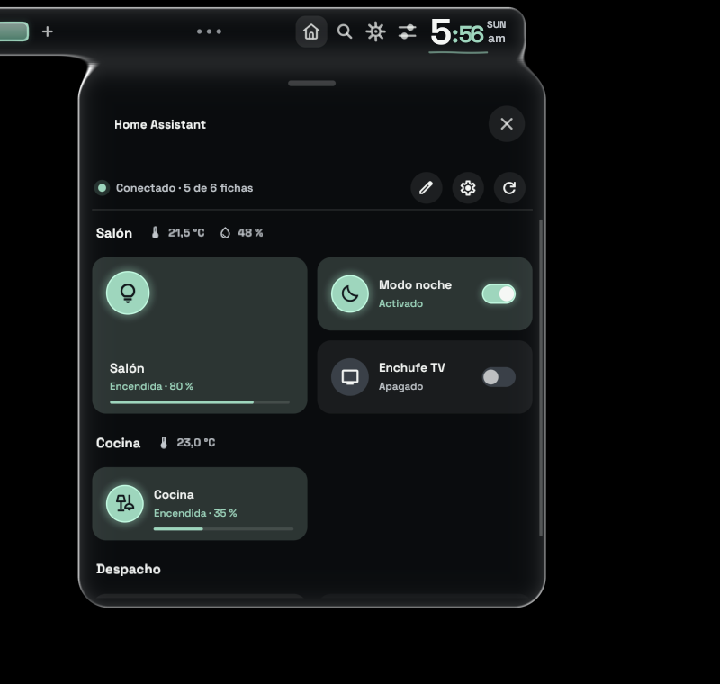
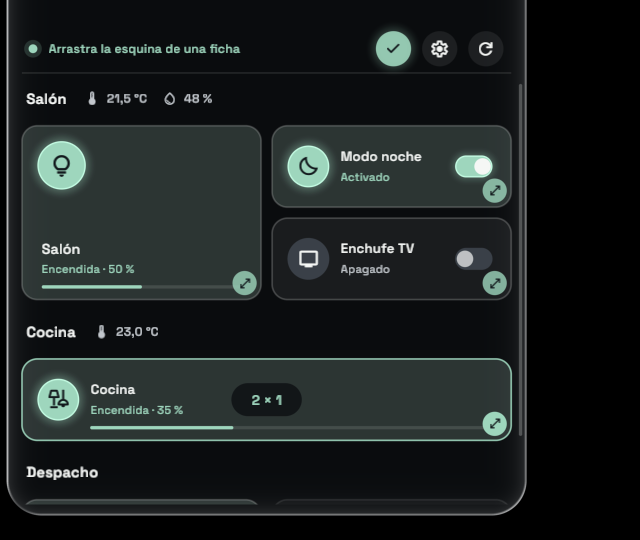
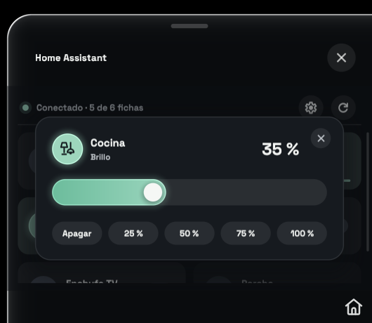
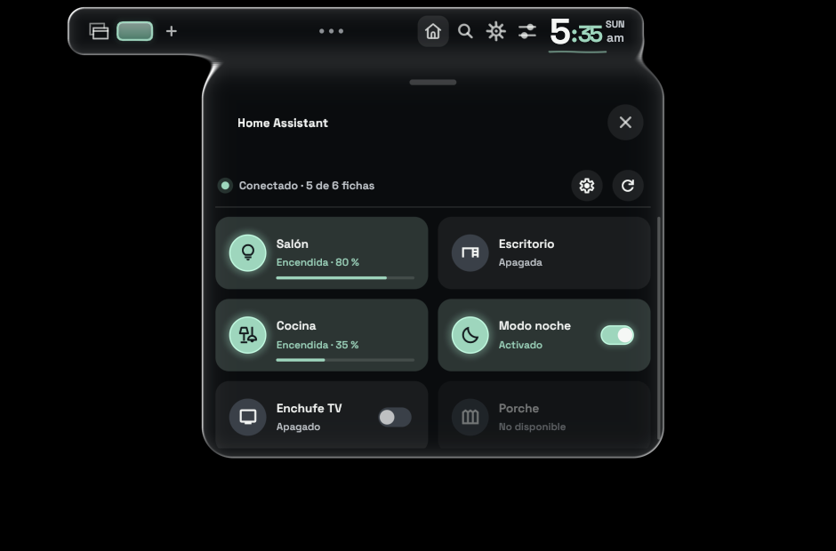
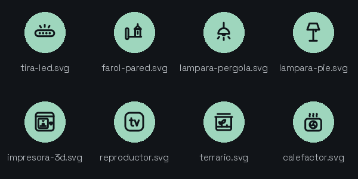

# Home Assistant para Vitreus

Un addon de [Vitreus](https://github.com/natepayn3/Vitreus) que pone tus luces e interruptores de Home Assistant en un panel con el cristal de la propia shell, separados por habitaciones.

*[Read in English](README.md)*



- **Habitaciones**, cada una con su nombre y, si le pones sensores, su temperatura y humedad.
- **Clic** en una ficha: enciende o apaga. **Clic derecho** en una luz: abre el control de brillo (arrastra, usa la rueda o pulsa Apagar / 25 / 50 / 75 / 100 %).
- **Fichas del tamaño que quieras**: el lápiz pone el panel en modo edición, y el tirador de la esquina de cada ficha la hace más ancha (hasta 4 columnas) o más alta (hasta 3 filas). Los tamaños se guardan.
- **En la isla**: arrastra la pieza de add-ons a la barra (Ajustes > Bar > Island layout) y el panel se despliega desde la barra como los paneles de la shell.
- **Estética de Vitreus**: toma la paleta y el tema de la shell, y cambia con ellos.

| Modo edición | Brillo | En la isla |
| --- | --- | --- |
|  |  |  |

## Instalar

```sh
git clone https://github.com/datingesp-hash/HomeAssistant-Vitreus-Addon ~/.config/pleamar/vitreus-addons/homeassistant
```

Después, actívalo en **Ajustes > Add-ons**. Para actualizarlo más adelante:

```sh
git -C ~/.config/pleamar/vitreus-addons/homeassistant pull
```

Necesita un Vitreus con add-ons, y `curl`.

## Configurar

La primera vez crea `~/.local/share/pleamar/homeassistant/config.json` con un ejemplo. El engranaje del panel lo abre, y al guardarlo el panel se actualiza solo. [`config.example.json`](config.example.json) es el mismo ejemplo.

- `url`: la dirección de tu Home Assistant, p. ej. `http://homeassistant.local:8123`.
- `token`: un token de larga duración. En Home Assistant: tu perfil > Seguridad > Tokens de acceso de larga duración > Crear token.
- `insecure`: `true` solo si usas https con un certificado propio.
- `rooms`: las habitaciones, en orden. Cada una lleva:
  - `name`: su nombre, que sale como título.
  - `temperature`, `humidity` (opcionales): un sensor; su lectura sale junto al nombre.
  - `items`: sus fichas. Cada ficha lleva:
    - `type`: `"light"` (con brillo) o `"toggle"`.
    - `name`: el nombre de la ficha.
    - `icon`: un nombre de [Material Symbols](https://fonts.google.com/icons) (`lightbulb`, `floor_lamp`, `tv`, `bedtime`, `mode_fan`…), uno de los iconos propios del addon (abajo), o cualquier `.svg` blanco que pongas en `~/.local/share/pleamar/homeassistant/`.
    - `entity`: la entidad, p. ej. `light.salon`.
    - `on_text`, `off_text` (opcionales): el texto de debajo cuando está encendido o apagado.

Un `items` suelto fuera de `rooms` también vale: sale arriba, sin título.

### Los iconos propios del addon

Para lo que Material Symbols no tiene un buen icono. Están dibujados sobre la cuadrícula de Material y se tiñen igual.



### Un atajo para abrirlo

En Hyprland (configuración en Lua), en tu `hyprland.lua`:

```lua
hl.unbind("SUPER + H")
hl.bind("SUPER + H", hl.dsp.exec_cmd("PATH=\"$HOME/.local/bin:$PATH\" pleamar --say vitreus \"emit ax_toggle\""))
```

`ax_toggle` abre el primer addon que tenga panel.

## Privacidad

El token nunca va en la línea de comandos de curl, donde otros programas podrían leerlo: el addon lo escribe en `auth.curl`, en su carpeta de datos, y curl lo lee de ahí con `-K`. Ese archivo y `config.json` guardan el token, así que ciérralos para otros usuarios:

```sh
chmod 600 ~/.local/share/pleamar/homeassistant/config.json ~/.local/share/pleamar/homeassistant/auth.curl
```

## Notas

- Con dos monitores del mismo tamaño, el panel sale en el que lo abriste (pregunta a Hyprland qué monitor tiene el foco).
- Hasta 12 habitaciones y 32 fichas.

## Licencia

MIT, ver [LICENSE](LICENSE). `addon-palette.plm` viene de la plantilla de add-ons de Vitreus (MIT, © natepayn3).
