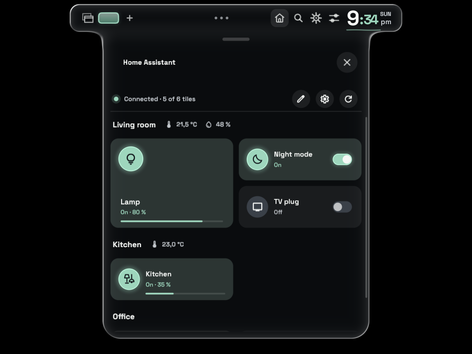
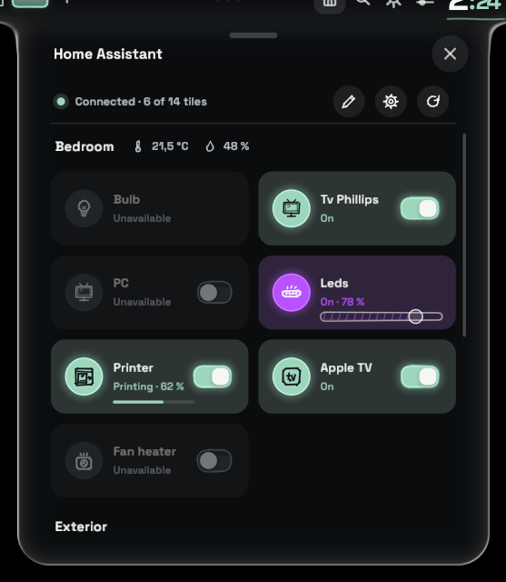
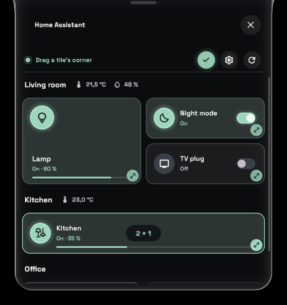
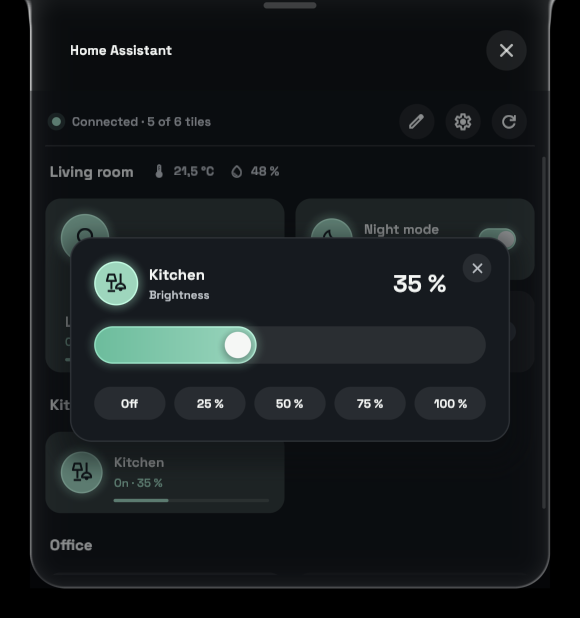
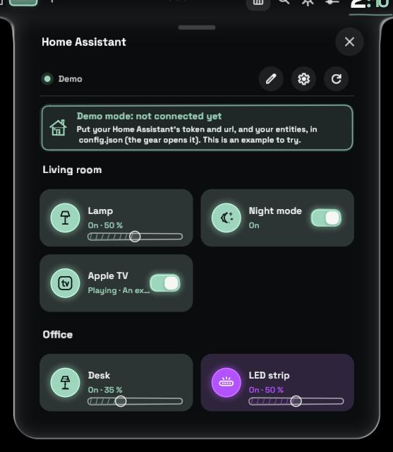
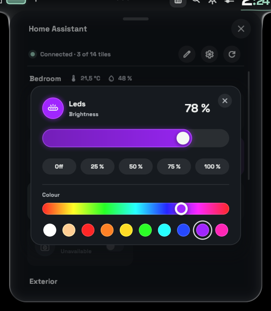
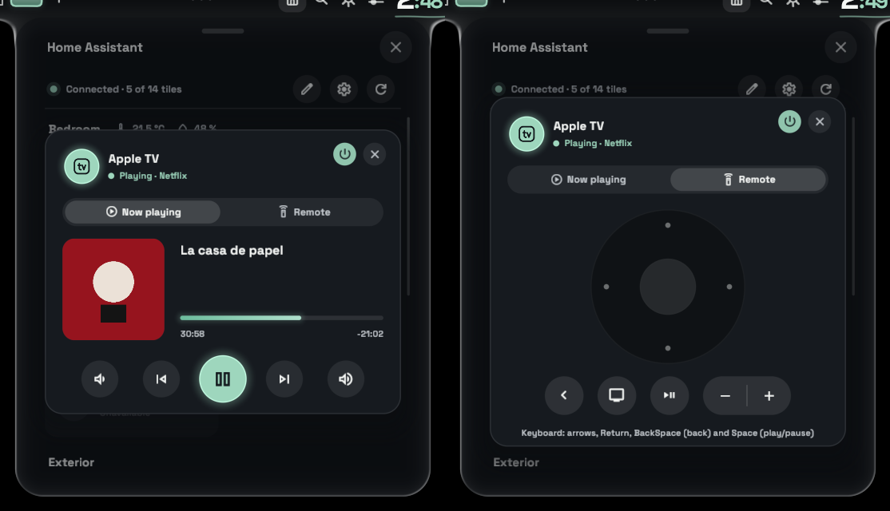
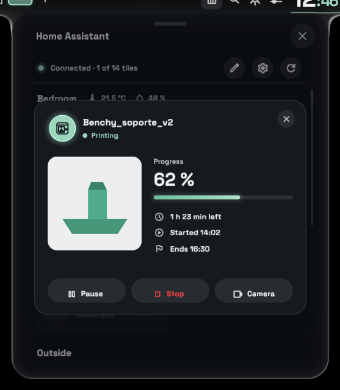
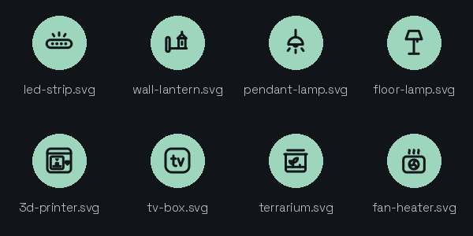

# Home Assistant for Vitreus

A [Vitreus](https://github.com/natepayn3/Vitreus) add-on that puts your Home Assistant lights and switches in a panel of the shell's own glass, grouped by room.

*[Leer en español](README.es.md)*



- **Rooms**, each with its name and, if you give it sensors, its temperature and humidity.
- **A click** turns a tile on or off. **A right click** on a light opens a brightness slider (drag it, use the wheel, or pick off / 25 / 50 / 75 / 100 %).
- **Colours**: a light with `"color": true` also gets a rainbow and a row of ready colours in that card, and its tile glows in the colour it has.
- **Apple TV**: a right click on its tile opens a card with what is playing (artwork, title, progress, transport and volume) and a remote like the Siri Remote's, which the keyboard drives too.
- **3D printers**: a right click on a printer's tile opens a card with the print's cover or camera, its progress and times, and its buttons.
- **Tiles of any size**: the pencil puts the panel in edit mode, and the handle in each tile's corner pulls it wider (up to 4 columns) or taller (up to 3 rows). Sizes are kept.
- **On the Island**: drag the add-ons piece onto the bar (Settings > Bar > Island layout) and the panel drops from the bar like the shell's own panels.
- **Vitreus's look**: it takes the palette and the theme from the shell, and changes with them; its switches, sliders and icons are the Control Center's pencil (from Vitreus's add-on template), and the content arrives as the Control Center's does.
- **A demo** until it is set up: with no token in `config.json` the panel says so in a banner and lets you play with the example's rooms.
- **Any language**: English by default, Spanish included, and any other from a JSON file you add (French.json, say): `"language"` in its settings picks it.
- Lights use `light.toggle` / `light.turn_on`; anything else (`input_boolean`, `switch`, `media_player`, scripts…) uses `homeassistant.toggle`.

| The panel | Edit mode | Brightness |
| --- | --- | --- |
|  |  |  |

## Install

```sh
git clone https://github.com/datingesp-hash/HomeAssistant-Vitreus-Addon ~/.config/pleamar/vitreus-addons/homeassistant
```

Then turn it on in **Settings > Add-ons**. To update it later:

```sh
git -C ~/.config/pleamar/vitreus-addons/homeassistant pull
```

It needs a Vitreus with add-ons, and `curl`.

## Set it up

The first time it runs it writes `~/.local/share/pleamar/homeassistant/config.json` with an example; the gear in the panel opens it in your editor (`$VISUAL`, then `$EDITOR`, then `nvim`), and the panel reloads when you save it. [`config.example.json`](config.example.json) is the same example.

Until it has a token, the panel is a **demo**: a banner at the top says what to put in `config.json`, and the rooms below (the example's, or yours) can be tried out, though nothing reaches Home Assistant.



- `language`: the language file to use, by its name: `"English"` (the default, also when it is left out), `"Spanish"`, or one you add (`"French"` for `French.json`). See [Translations](#translations).
- `url`: your Home Assistant's address, e.g. `http://homeassistant.local:8123`.
- `token`: a long-lived access token. In Home Assistant: your profile > Security > Long-lived access tokens > Create token.
- `insecure`: `true` only for https with a self-signed certificate.
- `icons` (optional): `"pencil"` (the default) draws the tiles with Vitreus's pencil icons, chosen by the icon's name: `lightbulb`, `floor_lamp`, `power`, `bedtime`, `mode_fan`, `tv`, `power_outlet`, `door_front`, `home` (and a few close names); any other name is a bulb for a light and a power sign for a switch. `"material"` draws any [Material Symbols](https://fonts.google.com/icons) name instead. An `.svg` of your own is drawn as it is either way.
- `artwork_search` (optional): `false` to not look up artwork online for an Apple TV (see its card, below).
- `rooms`: the rooms, in order. Each has:
  - `name`: shown as its title.
  - `temperature`, `humidity` (optional): a sensor entity; its reading is shown beside the name.
  - `items`: its tiles. Each has:
    - `type`: `"light"` (with brightness) or `"toggle"`.
    - `name`: what the tile says.
    - `icon`: an icon's name (`lightbulb`, `floor_lamp`, `tv`, `bedtime`, `mode_fan`…: see `icons` above), or one of the add-on's own icons below, or any white `.svg` you put in `~/.local/share/pleamar/homeassistant/`.
    - `entity`: the entity id, e.g. `light.living_room`.
    - `apple_tv` (optional): `{ "remote": "remote.living_room" }` on an Apple TV's tile gives it its card and remote (below).
    - `color` (optional, lights only): `true` for a light whose colour can change (an RGB bulb, an LED strip). Its right click card then shows the colours too.
    - `on_text`, `off_text` (optional): the line under the name when it is on or off.

A plain `items` list at the top level (without rooms) works too: it is shown first, with no title.

### Colours

Give a light `"color": true` and its right click card shows, below the brightness, a rainbow to drag along and ten ready colours: two whites, then around the wheel. The card's disc and track take the colour as you choose it, and so does the tile (its disc, its glow and its brightness bar), live. Choosing a colour on a light that is off turns it on at full brightness. The colour is sent as Home Assistant's `hs_color`, so the light has to support colour (`hs`, `rgb`, `rgbw`, `rgbww` or `xy` colour modes).

```json
{ "type": "light", "name": "LED strip", "icon": "led-strip.svg", "entity": "light.led_strip", "color": true }
```



### An Apple TV's card and remote

Give an Apple TV's tile an `"apple_tv"` block with its remote entity, and a right click on it opens a card with two tabs (a click still turns it on and off):

- **Now playing**: the artwork, the title and the series or artist, the app, how far it has got (it moves every second), and volume down, previous, play/pause, next and volume up. The power button is in the head.
- **Remote**: laid out as the Siri Remote: the clickpad (its four edges move, its middle selects, held it is a long press; the wheel over it moves up and down), and beside it back and TV (held: the control centre), play/pause and the volume rocker, and mute. While this tab is showing the keyboard drives it: the arrows, Return to select, BackSpace for back, Space for play/pause, and Escape shuts the card (the card takes the keyboard while it shows the remote, and gives it back when it shuts or goes back to the other tab).

```json
{ "type": "toggle", "name": "Apple TV", "icon": "tv-box.svg", "entity": "media_player.living_room",
  "apple_tv": { "remote": "remote.living_room" } }
```



These are the [Apple TV integration](https://www.home-assistant.io/integrations/apple_tv/)'s entities: it makes a `media_player.` and a `remote.` with the same name for each Apple TV (check yours in Settings > Devices & services > Apple TV). The remote's buttons go to `remote.send_command`, the rest to the media player (mute sets its volume to nothing and back, when it reports one). The card shrinks a little when the panel is not tall enough for it. If the tile's entity is not the media player, add `"media_player": "media_player.…"` to the block. Without `remote` the card has no remote tab, so it works for any other media player too. While it plays, the tile says so: *Playing · La casa de papel*.

**Artwork.** Home Assistant often has none: many apps (Crunchyroll and most that are not Apple's) give the Apple TV no artwork. Then the add-on looks it up in the free public catalogue that knows that kind of thing best (none needs an account or a key), chosen by the app and by what it plays:

| What plays | Where |
| --- | --- |
| Music (Spotify, Music…) with its artist | [Deezer](https://developers.deezer.com/api), the album's cover; then Apple's iTunes |
| A series, in an anime app (Crunchyroll…) | [AniList](https://anilist.co), its cover |
| A series, in any other app | [TVmaze](https://www.tvmaze.com/api), its poster; then iTunes |
| Only a title | iTunes, a film with exactly that title; then TVmaze, a series with exactly that name |
| None of that found | the app's own icon (iTunes), over its name |

A match must carry the name it was asked for, so a near miss shows the app's icon rather than somebody else's poster. What the Apple TV sends decides how far it gets: Crunchyroll, for one, sends only the episode's title (no series), so it shows its icon. Only the series, the title, the artist and the app's name are sent; each is asked once and kept. `"artwork_search": false` turns it off.

### A 3D printer's card

Give a tile a `"printer"` block and a right click on it opens a card with the print: the model's cover (or the printer's camera), the job, its state, its progress, the time left, when it started and when it ends, and Pause / Resume / Stop (Stop asks again). A click on the tile still toggles its own entity (the printer's light, say), and while it prints the tile shows *Printing · 62 %* with a bar. Every entity is optional; leave out the ones your printer does not have.

```json
{ "type": "toggle", "name": "Printer", "icon": "3d-printer.svg", "entity": "light.p1p_chamber_light",
  "printer": {
    "task":      "sensor.p1p_task_name",
    "progress":  "sensor.p1p_print_progress",
    "remaining": "sensor.p1p_remaining_time",
    "status":    "sensor.p1p_print_status",
    "start":     "sensor.p1p_start_time",
    "end":       "sensor.p1p_end_time",
    "cover":     "image.p1p_cover_image",
    "camera":    "camera.p1p_camera",
    "pause":     "button.p1p_pause_printing",
    "resume":    "button.p1p_resume_printing",
    "stop":      "button.p1p_stop_printing"
  } }
```



These are the [Bambu Lab integration](https://github.com/greghesp/ha-bambulab)'s entities for a printer called P1P (their names follow Home Assistant's language and your printer's name: check yours in Settings > Devices & services > Entities). `status` understands `running`, `pause`, `finish`, `failed`, `prepare`, `idle` and `offline`; `remaining` is read in its own unit (minutes, hours or seconds). The camera shows a frame every two seconds inside the card; a click on it opens the live stream in your browser.

### The add-on's own icons

For what Material Symbols has no good icon for. With the default `"icons": "pencil"` they are drawn in Vitreus's pencil like the rest (they boil under the pointer); with `"material"` they are the white `.svg` files below, tinted the same way. All of the panel's own icons (its buttons, the cards, the remote) are pencil drawings too, from `ha-icons.plm`, which `tools/icons.py` writes from a table of strokes. Each has an English and a Spanish name, and either works in `icon`:



| English | Spanish |
| --- | --- |
| `led-strip.svg` | `tira-led.svg` |
| `wall-lantern.svg` | `farol-pared.svg` |
| `pendant-lamp.svg` | `lampara-pergola.svg` |
| `floor-lamp.svg` | `lampara-pie.svg` |
| `3d-printer.svg` | `impresora-3d.svg` |
| `tv-box.svg` | `reproductor.svg` |
| `terrarium.svg` | `terrario.svg` |
| `fan-heater.svg` | `calefactor.svg` |

### A key to open it

On Hyprland (Lua config), in your `hyprland.lua`:

```lua
hl.unbind("SUPER + H")
hl.bind("SUPER + H", hl.dsp.exec_cmd("PATH=\"$HOME/.local/bin:$PATH\" pleamar --say vitreus \"emit ax_toggle\""))
```

`ax_toggle` opens the first add-on that has a panel.

## Translations

Every word the panel shows is in a JSON file in its data folder, `~/.local/share/pleamar/homeassistant/`: `English.json` and `Spanish.json` are written there the first time it runs, one text a line, and can be edited (a newer version of the add-on adds the texts it brings and keeps your edits). To add a language:

1. Copy `English.json` as, say, `French.json`, in the same folder.
2. Translate the texts on the right of each line. Keep the names on the left as they are, and keep `%s` and `%d` where they are (a name or a number goes there).
3. Set `"_code"` to the language's two letters (`"fr"`): it is the country whose catalogue the Apple TV's artwork is looked up in.
4. Put `"language": "French"` in `config.json`. The panel changes as soon as either file is saved.

A text the file lacks is said in English, so a translation can be done a bit at a time. To share one, open an issue or a pull request with the file, and it will come with the add-on.

## Privacy

The token is never put on curl's command line, where other programs could read it: the add-on writes it to `auth.curl` in its data folder and curl reads it from there with `-K`.

That folder (`~/.local/share/pleamar/homeassistant/`, which holds `config.json` and `auth.curl`, both with the token) is private: pleamar after 0.4.31 keeps a scene's data folder 0700 and the files it writes 0600 ([pleamar#107](https://github.com/k4ditano/pleamar/issues/107)). A folder made before is tightened too, since the add-on writes `auth.curl` every time it starts. With pleamar 0.4.31 or older, do it by hand:

```sh
chmod 700 ~/.local/share/pleamar/homeassistant
```

Either way this keeps the token from other users of the machine; programs running as you can still read it.

An Apple TV's artwork lookup (above) asks public catalogues (Deezer, AniList, TVmaze, iTunes) with what is playing (series, title, artist, app); turn it off with `"artwork_search": false`.

## Notes

- With two monitors of the same size, the panel shows on the one Vitreus opened it on (Vitreus tells the add-on the monitor's name; an older Vitreus that does not falls back to the monitor's size).
- Up to 12 rooms and 32 tiles.

## License

MIT, see [LICENSE](LICENSE). `addon-palette.plm` comes from Vitreus's add-on template (MIT, © natepayn3).
