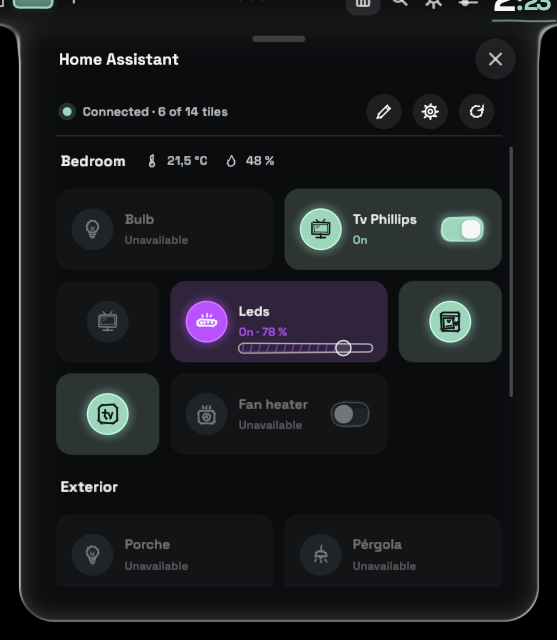
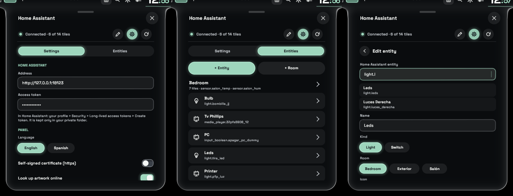
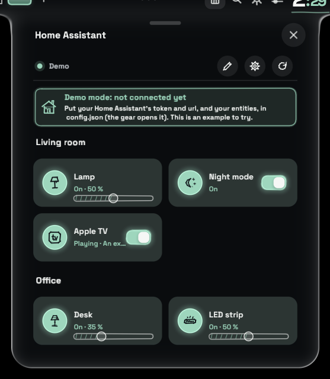
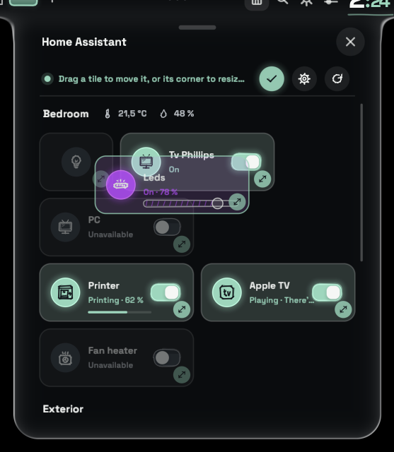
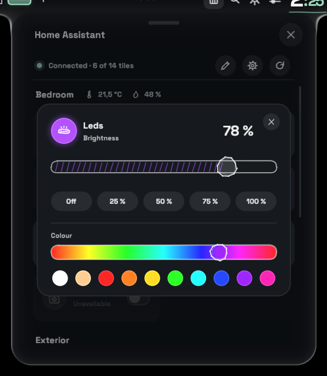
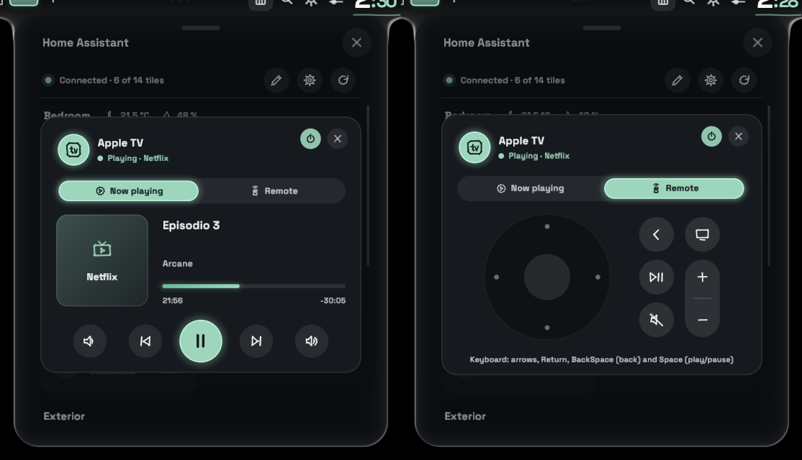
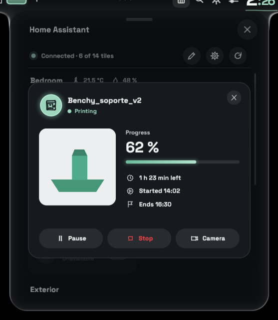

# Home Assistant for Vitreus

A [Vitreus](https://github.com/natepayn3/Vitreus) add-on that brings your Home Assistant home into the shell: lights, switches, an Apple TV and a 3D printer, grouped by room, in a panel made of Vitreus's own glass.

It speaks English by default and ships with a Spanish translation already installed (see [Languages](#languages)).



## Contents

- [Features](#features)
- [Install and update](#install-and-update)
- [Setting it up](#setting-it-up)
- [Using the panel](#using-the-panel)
- [Lights and colours](#lights-and-colours)
- [Apple TV](#apple-tv)
- [3D printer](#3d-printer)
- [Icons](#icons)
- [Languages](#languages)
- [config.json reference](#configjson-reference)
- [Privacy](#privacy)
- [Notes](#notes)
- [License](#license)

## Features

- **Rooms and tiles.** Each room has a title and, optionally, its temperature and humidity. A click turns a tile on or off.
- **Lights.** A right click opens a brightness card. Colour lights can also get a colour picker, and their tiles can be tinted in the colour they have.
- **Apple TV.** A card shows what is playing, with artwork, progress, transport controls and volume. A second tab holds a remote laid out like the Siri Remote, which the keyboard can drive too.
- **3D printer.** A card shows the print's cover or the live camera, its progress and times, and Pause / Resume / Stop buttons.
- **Settings menu.** The gear opens a settings page where you set everything from the panel itself, with no JSON needed. Your entities are suggested as you type.
- **Edit mode.** You can resize tiles in half columns, down to icon-only tiles, and drag them to rearrange.
- **Native look.** It uses Vitreus's palette, theme, pencil icons, switches and sliders, and follows the shell when its theme changes.
- **Demo mode** until a token is set, so you can try the panel before connecting it.
- **Translatable.** Every text lives in a JSON file. English and Spanish are included, and adding a language is just one more file.

## Install and update

You need a Vitreus with add-on support, and `curl`.

```sh
git clone https://github.com/datingesp-hash/HomeAssistant-Vitreus-Addon ~/.config/pleamar/vitreus-addons/homeassistant
```

Then turn it on in Vitreus under **Settings > Add-ons**.

To update, pull and restart Vitreus:

```sh
git -C ~/.config/pleamar/vitreus-addons/homeassistant pull
```

## Setting it up

### From the panel

Click the **gear** to open the settings. It has two tabs.

**Settings**
- Home Assistant's address and a long-lived access token. To make the token in Home Assistant, go to your profile > Security > Long-lived access tokens > Create token.
- The panel's language.
- A switch for HTTPS with a self-signed certificate.
- A switch for looking up Apple TV artwork online.

**Entities**
- **+ Room** and **+ Entity** add one. Click an existing room or tile to edit it.
- An entity is found by typing. The suggestions are your Home Assistant entities, matched by id or by name.
- For each tile you choose:
  - its name, kind (light or switch), room and icon;
  - the on/off texts;
  - the options that fit it: colour picker and tint for a light, card and remote for a media player, card for a printer.
- A Bambu Lab printer is detected automatically, and all its entities are filled in for you.
- A room has a name and optional temperature and humidity sensors. Rooms can be moved up or down, or deleted.

Fields are typed through Vitreus's own text field. Hover a field, then click it to type. Each change is saved right away: press Enter, move to another field, or flip a switch.



### By hand

Everything is stored in `~/.local/share/pleamar/homeassistant/config.json`. On first run the add-on writes it with an example, the same as [`config.example.json`](config.example.json). The settings menu writes this file in a fixed order and keeps its notes, so you can still edit it by hand.

**Open config.json in the editor**, at the bottom of the settings, opens the file through Vitreus's `vitreus-edit`. That uses `$VISUAL`, `$EDITOR` or your desktop's text editor. If no editor is found, the panel says so and copies the file's path. The panel reloads as soon as the file is saved.

See the [config.json reference](#configjson-reference) for every key.

### Demo mode

Until a token is set, the panel runs as a demo. A banner explains what is missing, and the rooms below can be tried out, but nothing is sent to Home Assistant.



## Using the panel

- **Click** a tile to toggle it.
- **Right click** a light, an Apple TV or a printer to open its card.
- The **refresh** button reloads states from Home Assistant.

### Edit mode

The **pencil** button puts the panel in edit mode.

- **Resize** a tile with the handle in its corner. Width goes in half columns, up to 4 columns: a half-column tile shows only its icon. Height goes up to 3 rows. The size being pulled is shown on the tile.
- **Move** a tile by dragging it from the middle. Drop it on another tile to take that tile's place, or on a room to put it at the end of that room.

The new order is saved to `config.json`, and sizes to `layout.json` beside it.



### On the Island

Drag the add-ons piece onto the bar (**Settings > Bar > Island layout**), and the panel drops down from the bar like the shell's own panels.

### A key to open it

`ax_toggle` opens the first add-on that has a panel. On Hyprland (Lua config), add this to `hyprland.lua`:

```lua
hl.unbind("SUPER + H")
hl.bind("SUPER + H", hl.dsp.exec_cmd("PATH=\"$HOME/.local/bin:$PATH\" pleamar --say vitreus \"emit ax_toggle\""))
```

## Lights and colours

A right click on a light opens its card. You can change the brightness by:
- dragging the slider;
- scrolling the wheel;
- picking off, 25, 50, 75 or 100 %.

There are two optional settings for colour lights (RGB bulbs, LED strips):

| Setting | What it does |
| --- | --- |
| `"color": true` | Adds a colour section to the card: a hue bar to drag along, and ten ready colours (two whites, then around the wheel). |
| `"tint": true` | Draws the tile and the card in the light's current colour instead of the theme's accent, and updates live as you choose. |

Picking a colour on a light that is off turns it on at full brightness. Colours are sent as `hs_color`, so the light must support a colour mode (`hs`, `rgb`, `rgbw`, `rgbww` or `xy`).

```json
{ "type": "light", "name": "LED strip", "icon": "led-strip.svg", "entity": "light.led_strip", "color": true, "tint": true }
```



## Apple TV

Add an `apple_tv` block with the remote entity to an Apple TV's tile:

```json
{ "type": "toggle", "name": "Apple TV", "icon": "tv-box.svg", "entity": "media_player.living_room",
  "apple_tv": { "remote": "remote.living_room" } }
```

A click still turns it on or off. A right click opens a card with two tabs.

**Now playing**
- Artwork, title, series or artist, and the app.
- Live progress.
- Volume down, previous, play/pause, next, volume up.
- Power, in the card's header.

**Remote**
- Laid out like the Siri Remote:
  - the clickpad: its edges move, its centre selects, and holding it does a long press; the wheel moves up and down;
  - back and TV (hold TV for Control Centre);
  - play/pause, the volume rocker and mute.
- While this tab is open, the keyboard drives it:

  | Key | Does |
  | --- | --- |
  | Arrows | Move |
  | Return | Select |
  | BackSpace | Back |
  | Space | Play/pause |
  | Escape | Close the card |

  The card gives the keyboard back when it closes or you switch tabs.



While it plays, the tile itself says so, for example *Playing · La casa de papel*.

These are the entities the [Apple TV integration](https://www.home-assistant.io/integrations/apple_tv/) makes: a `media_player.` and a `remote.` with the same name.
- If the tile's entity is not the media player, add `"media_player": "media_player.…"` to the block.
- Without `remote`, the card has no remote tab, so it works for any other media player too.
- The card shrinks a little when the panel is not tall enough for it.

### Artwork

Many apps, including Crunchyroll and most non-Apple apps, give Home Assistant no artwork. When that happens, the add-on looks the artwork up in a free public catalogue chosen by the app and by what is playing. None of them needs an account or an API key.

| What is playing | Where the artwork comes from |
| --- | --- |
| Music with an artist (Spotify, Music…) | [Deezer](https://developers.deezer.com/api) album cover, then iTunes |
| A series in an anime app (Crunchyroll…) | [AniList](https://anilist.co) cover |
| A series in any other app | [TVmaze](https://www.tvmaze.com/api) poster, then iTunes |
| Only a title | iTunes film with that exact title, then a TVmaze series with that exact name |
| Nothing found | The app's own icon, over its name |

A match must carry the exact name it was asked for, so a near miss shows the app's icon rather than the wrong poster. Results are looked up once and cached.

What the app sends sets the limit. Netflix and Crunchyroll, for example, don't send the series name, so they show the app's icon.

Turn the lookup off with `"artwork_search": false`, or with its switch in the settings.

## 3D printer

Add a `printer` block to a tile. Every entity is optional: leave out the ones your printer doesn't have.

```json
{ "type": "toggle", "name": "Printer", "icon": "3d-printer.svg", "entity": "light.p1p_chamber_light",
  "printer": {
    "task":      "sensor.p1p_task_name",
    "progress":  "sensor.p1p_print_progress",
    "remaining": "sensor.p1p_remaining_time",
    "status":    "sensor.p1p_print_status",
    "start":     "sensor.p1p_start_time",
    "end":       "sensor.p1p_end_time",
    "cover":     "image.p1p_cover_image",
    "camera":    "camera.p1p_camera",
    "pause":     "button.p1p_pause_printing",
    "resume":    "button.p1p_resume_printing",
    "stop":      "button.p1p_stop_printing"
  } }
```

A right click opens the card. It shows:
- the model's cover, or the camera, refreshed every two seconds (click it to open the live stream in your browser);
- the job, its state, progress, time left, start and end;
- Pause / Resume / Stop. Stop asks for confirmation.

A click on the tile still toggles its own entity (the chamber light, say). While printing, the tile shows *Printing · 62 %* with a progress bar.



The example uses the [Bambu Lab integration](https://github.com/greghesp/ha-bambulab)'s entities for a printer named P1P. In the settings menu a Bambu printer is detected and filled in for you.
- `status` understands `running`, `pause`, `finish`, `failed`, `prepare`, `idle` and `offline`.
- `remaining` is read in its own unit: minutes, hours or seconds.

## Icons

Every icon in the panel is drawn in Vitreus's pencil style, and it sketches itself when hovered or lit. You can pick an icon from the settings menu, or set `icon` by hand. There are three kinds:

1. **Pencil icons**, by name:
   - `lightbulb`, `floor_lamp`, `power`, `bedtime`, `mode_fan`, `tv`, `power_outlet`, `door_front`, `home`, and a few close names.
   - An unknown name falls back to a bulb for a light, and a power sign for a switch.
2. **The add-on's own icons**, also in pencil:

   | Icon | File |
   | --- | --- |
   | LED strip | `led-strip.svg` |
   | Wall lantern | `wall-lantern.svg` |
   | Pendant lamp | `pendant-lamp.svg` |
   | Floor lamp | `floor-lamp.svg` |
   | 3D printer | `3d-printer.svg` |
   | TV box | `tv-box.svg` |
   | Terrarium | `terrarium.svg` |
   | Fan heater | `fan-heater.svg` |

   Their Spanish file names (`tira-led.svg`, `impresora-3d.svg`…) work too.
3. **Your own**: put any white `.svg` in `~/.local/share/pleamar/homeassistant/` and use its file name.

## Languages

English is the default. **A Spanish translation comes installed with the add-on.** To use it, choose it in the settings menu or set `"language": "Spanish"` in `config.json`.

Every text the panel shows lives in a JSON file in `~/.local/share/pleamar/homeassistant/`. `English.json` and `Spanish.json` are written there on first run. You can edit them: updates add new texts and keep your edits.

To add a language:

1. Copy `English.json` to, say, `French.json`, in the same folder.
2. Translate the text on the right of each line.
   - Keep the keys on the left unchanged.
   - Keep `%s` and `%d` where they are.
3. Set `"_code"` to the language's two-letter code (`"fr"`). It also picks the country used for artwork lookups.
4. Choose it in the settings menu, or set `"language": "French"` in `config.json`. The panel switches as soon as the file is saved.

Missing texts fall back to English, so you can translate a little at a time. To share a translation, open an issue or a pull request with the file and it will ship with the add-on.

## config.json reference

| Key | Meaning |
| --- | --- |
| `language` | Language file to use: `"English"` (the default), `"Spanish"`, or one you added. |
| `url` | Home Assistant's address, e.g. `http://homeassistant.local:8123`. |
| `token` | A long-lived access token. |
| `insecure` | `true` only for HTTPS with a self-signed certificate. |
| `artwork_search` | `false` to stop looking up Apple TV artwork online. |
| `rooms` | The rooms, in order. |

Each room:

| Key | Meaning |
| --- | --- |
| `name` | The room's title. |
| `temperature`, `humidity` | Optional sensor entities, shown beside the title. |
| `items` | The room's tiles. |

Each tile:

| Key | Meaning |
| --- | --- |
| `type` | `"light"` (with brightness) or `"toggle"`. |
| `name` | The tile's label. |
| `entity` | The entity id, e.g. `light.living_room`. |
| `icon` | An icon name or `.svg` file (see [Icons](#icons)). |
| `on_text`, `off_text` | Optional line under the name when it is on or off. |
| `color` | Lights only: show the colour picker. |
| `tint` | Lights only: draw the tile and card in the light's colour. |
| `apple_tv` | `{ "remote": "remote.…" }`: the Apple TV card (see [Apple TV](#apple-tv)). |
| `printer` | The printer card's entities (see [3D printer](#3d-printer)). |

Tile sizes set in edit mode are kept apart, in `layout.json`. A plain `items` list at the top level (outside any room) also works: it is shown first, with no title.

Lights use `light.toggle` and `light.turn_on`. Everything else (`switch`, `input_boolean`, `media_player`, scripts…) uses `homeassistant.toggle`.

## Privacy

**The token never goes on curl's command line**, where other programs could see it. The add-on writes it to `auth.curl` in its data folder, and curl reads it from there with `-K`.

**The data folder is private.** `~/.local/share/pleamar/homeassistant/` holds `config.json` and `auth.curl`, both of which contain the token.
- pleamar after 0.4.31 keeps a scene's data folder at 0700 and its files at 0600 ([pleamar#107](https://github.com/k4ditano/pleamar/issues/107)).
- With pleamar 0.4.31 or older, tighten it yourself:

  ```sh
  chmod 700 ~/.local/share/pleamar/homeassistant
  ```

This keeps the token from other users of the machine. Programs running as you can still read it.

**Artwork lookups** send only the series, title, artist and app name to the catalogues listed above (Deezer, AniList, TVmaze, iTunes). Turn them off with `"artwork_search": false`.

## Notes

- Up to 12 rooms and 32 tiles.
- With two monitors of the same size, the panel opens on the one Vitreus opened it from.
- The repository's lint workflow runs Vitreus's add-on checks (`vitreus-sync-addons lint`) on every push.

## License

MIT, see [LICENSE](LICENSE). `addon-palette.plm`, `addon-theme.plm` and `addon-pencil.plm` come from Vitreus's add-on template (MIT, © natepayn3).
